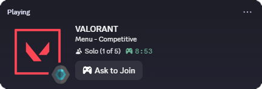
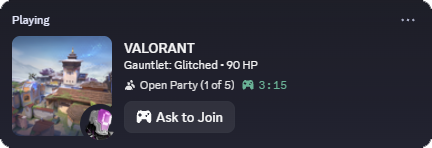

 

**A lightweight Discord Rich Presence client for VALORANT.**  
Displays live match scores, map splash art, locked agent portraits, competitive ranks (`RR` & Leaderboard `#`), queue timers, and party details directly on your Discord profile—without the native Discord and Riot Games linking.

 

<table>
  <tr>
    <td align="center">
      
    </td>
    <td align="center">
      
    </td>
  </tr>
</table>

---

## ✨ Features

- **Match Telemetry**: Displays real-time round scores, current gamemode, map splash art, locked agent portraits, competitive ranks (`RR` & leaderboard standing), and elapsed timers for matches, queues, and agent select.
- **Discord Party Invitations**: Retains native Discord party invitation and **Ask to Join** features when your Discord account is linked to Riot Games.
- **Lightweight**: Runs silently in the Windows System Tray with zero presence while VALORANT is closed, automatically connects when the game starts, and includes seamless background auto-updates.

---

## 🚀 Installation

1. Download **[`VALORANT-RPC-Setup.exe`](https://github.com/karlchastin/VALORANT-Discord-Rich-Presence/releases/latest/download/VALORANT-RPC-Setup.exe)** from the [Latest Release](https://github.com/karlchastin/VALORANT-Discord-Rich-Presence/releases/latest).
2. Run `VALORANT-RPC-Setup.exe` to launch the Setup Wizard.
3. Review the license and disclaimer, select your installation directory, and click **Install**.

To uninstall at any time, right-click the **VALORANT RPC** system tray icon and select **Uninstall**, or remove it via **Windows Settings → Apps → Installed Apps**.

---

## 🙏 Credits & Acknowledgements

This project is built upon the foundational work created by [colinhartigan](https://github.com/colinhartigan) in [colinhartigan/valorant-rpc](https://github.com/colinhartigan/valorant-rpc). This would not have been possible without his original architecture. Subsequent forks by [tubxi](https://github.com/tubxi) and [krvntzkl](https://github.com/krvntzkl) also helped with this further development.

---

## 📜 Terms of Use & Disclaimer

Please read this agreement carefully before installing or using **VALORANT RPC**. By installing or using this software, you agree to the terms below:

### 1. Riot Games & Anti-Cheat Disclaimer
**VALORANT RPC** is a passive Discord Rich Presence integration. It only reads local Riot Client session/presence status and public game metadata to display your current mode, map, agent, rank, and match score on Discord. It does **not** read, hook, inject into, or modify VALORANT game memory, game files, or Riot Vanguard, and provides no gameplay advantage.

According to Riot Games Customer Support and Riot's Third-Party Application policy, passive external tools that do not interact with game memory or provide an unfair advantage are not bannable. However, because this is an unofficial community project not affiliated with or certified by Riot Games, this is not 100% guaranteed. You use this software at your own discretion and risk.

### 2. "AS IS" Software & Automatic Updates
This software is provided **"AS IS"**, without warranty of any kind, express or implied. In no event shall the authors or contributors be liable for any claim, damages, or account actions arising from the use of this software.

This software includes an automatic update system that checks official GitHub Releases and installs updates automatically to maintain compatibility with new VALORANT patches.

### 3. Trademark Notice
**VALORANT RPC** is not endorsed by Riot Games and does not reflect the views or opinions of Riot Games or anyone officially involved in producing or managing Riot Games properties. Riot Games and VALORANT are trademarks or registered trademarks of Riot Games, Inc.
